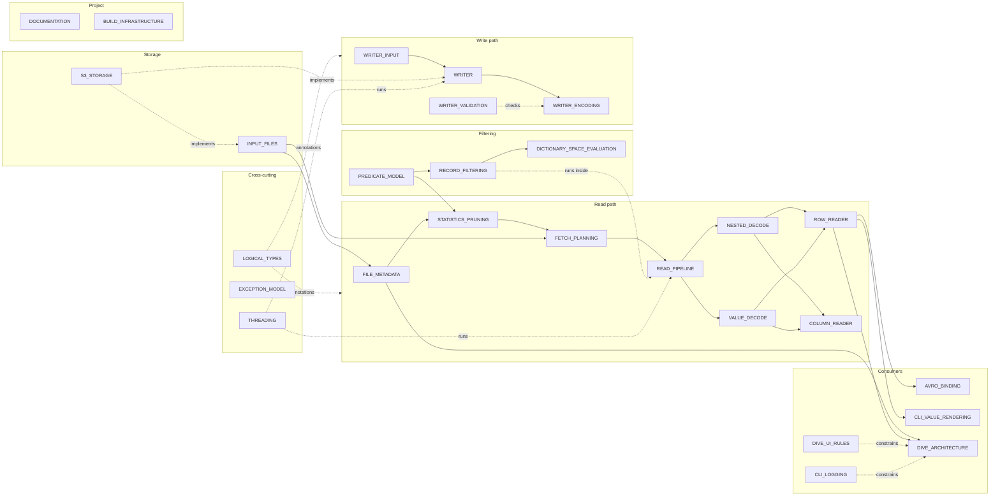

# Hardwood Architecture

A minimal-dependency Apache Parquet reader and writer in Java.

## What This Is

Hardwood reads and writes Parquet files without Hadoop or parquet-java. It implements the Parquet format specification from scratch: the Thrift Compact Protocol for the footer and page headers, the standard encodings, the page index and bloom filters, and the Dremel shredding and assembly of nested data. The design of each subsystem is in `_designs/`; this page is the map.

## Design Documents

Solid arrows follow data through a read or a write; dotted arrows mark a document that constrains or checks another.

| Area | Documents |
|---|---|
| Read path | [READ_PIPELINE.md](_designs/READ_PIPELINE.md) (row groups to published batches, batch sizing, multi-file planning), [ROW_READER.md](_designs/ROW_READER.md), [COLUMN_READER.md](_designs/COLUMN_READER.md), [NESTED_DECODE.md](_designs/NESTED_DECODE.md) (levels to nested batches), [VALUE_DECODE.md](_designs/VALUE_DECODE.md) (page values to Java values) |
| Filtering | [PREDICATE_MODEL.md](_designs/PREDICATE_MODEL.md) (the `FilterPredicate` API and its resolution), [STATISTICS_PRUNING.md](_designs/STATISTICS_PRUNING.md) (pruning row groups and pages from metadata), [RECORD_FILTERING.md](_designs/RECORD_FILTERING.md) (exact row filtering on both readers), [DICTIONARY_SPACE_EVALUATION.md](_designs/DICTIONARY_SPACE_EVALUATION.md) (binary predicates decided once per dictionary entry) |
| I/O and metadata | [INPUT_FILES.md](_designs/INPUT_FILES.md), [S3_STORAGE.md](_designs/S3_STORAGE.md), [FETCH_PLANNING.md](_designs/FETCH_PLANNING.md) (which bytes a read requests), [FILE_METADATA.md](_designs/FILE_METADATA.md) (footer, Thrift parsing, page index), [EXCEPTION_MODEL.md](_designs/EXCEPTION_MODEL.md) |
| Threading | [THREADING.md](_designs/THREADING.md) (which thread runs a read's and a writer's work: the context's pool, virtual threads for I/O, contexts of zero threads) |
| Writer | [WRITER.md](_designs/WRITER.md) (write model, row-group lifecycle, memory), [WRITER_INPUT.md](_designs/WRITER_INPUT.md) (schema builder, `ColumnBatch`, shredding, `RowWriter`), [WRITER_ENCODING.md](_designs/WRITER_ENCODING.md) (page layout, dictionary selection, codecs, statistics), [WRITER_VALIDATION.md](_designs/WRITER_VALIDATION.md) (interop gate) |
| Types | [LOGICAL_TYPES.md](_designs/LOGICAL_TYPES.md) (annotations, timestamps, Variant, geospatial), [AVRO_BINDING.md](_designs/AVRO_BINDING.md) (`hardwood-avro`) |
| CLI | [DIVE_ARCHITECTURE.md](_designs/DIVE_ARCHITECTURE.md), [DIVE_UI_RULES.md](_designs/DIVE_UI_RULES.md), [CLI_VALUE_RENDERING.md](_designs/CLI_VALUE_RENDERING.md), [CLI_LOGGING.md](_designs/CLI_LOGGING.md) (stdout, stderr and log records) |
| Project | [DOCUMENTATION.md](_designs/DOCUMENTATION.md), [BUILD_INFRASTRUCTURE.md](_designs/BUILD_INFRASTRUCTURE.md), [TESTING.md](TESTING.md), [PERFORMANCE.md](PERFORMANCE.md), [NATIVE_BUILD.md](NATIVE_BUILD.md), [FORMAT_COVERAGE.md](FORMAT_COVERAGE.md) |

Implementation plans for work spanning several PRs are in `_plans/`.

## Key Design Decisions

### Custom Thrift Parser
The Thrift Compact Protocol is implemented from scratch (`internal/thrift/`) instead of using the Thrift library. This removes a heavyweight dependency and gives control over parsing policy and memory allocation ([FILE_METADATA.md](_designs/FILE_METADATA.md)).

### Flat vs Nested Split
A file whose top-level fields are all primitive and whose columns have no repetition is read by `FlatRowReader`, which serves accessors straight from each column's typed value array and validity bitmap. Any other schema is read by `NestedRowReader`, which navigates offsets derived from the repetition and definition levels ([ROW_READER.md](_designs/ROW_READER.md)).

### Primitive-First API
The public API (`PqIntList`, `getLong()`, `ColumnReader`'s typed arrays) avoids boxing wherever possible. Internal code uses primitive arrays (`int[]`, `long[]`) rather than `List<Integer>`.

### Row-Ordered Decode into Batches
Each decoded column (the projection plus any filter-only predicate columns) fetches its pages in steps on a fixed platform-thread pool owned by the `HardwoodContext`, and its reads run on virtual threads. One scheduler per read submits every column's pages, in row order, to the same pool, where they are decoded straight into batches, with back-pressure towards the consumer ([READ_PIPELINE.md](_designs/READ_PIPELINE.md), [THREADING.md](_designs/THREADING.md)).

### Minimal Dependencies
`hardwood-core` has no required runtime dependency. GZIP goes through the JDK; the other codecs use compression libraries that are optional, needed only for the codecs a file uses. LZO is not supported. `hardwood-s3` implements its S3 client and SigV4 signing without the AWS SDK.

## Module Overview

| Module | Purpose |
|--------|---------|
| `core` | The Parquet reader and writer library |
| `s3` | Reading from and writing to S3-compatible object storage |
| `aws-auth` | Bridges the AWS SDK credential chain to Hardwood's credential types |
| `avro` | Reading rows as Avro `GenericRecord`s |
| `cli` | The `hardwood` command-line tool, including the `dive` TUI |
| `parquet-java-compat` | parquet-java API compatibility layer without parquet-java or Hadoop dependencies |
| `integration-test` | Tests of `hardwood-core` consumed as a packaged dependency, on the Java 21 baseline |
| `parquet-testing-runner` | Tests against the apache/parquet-testing files, compared with parquet-java |
| `performance-testing` | Benchmarks (enable with `-Pperformance-test`) |
| `bom`, `test-bom` | Bills of materials for Hardwood and its test dependencies |
| `test-support` | Test helpers shared across modules |
| `error-prone-checks` | The project's Error Prone checks |
| `tools/predicate-audit` | Audit of the predicate literal rule against an oracle, parquet-java and DuckDB (enable with `-Ppredicate-audit`) |

## Read Path Packages

The read path in `core` is split into packages by responsibility. Each package depends only on the packages above it in this table, which `ReadPathLayersTest` checks. Two packages sit beside the table: `HardwoodContextImpl` (`dev.hardwood.internal`), which every layer is handed, and `internal.predicate`, which the layers from `footer` up use and which uses the batch model, dictionary parsing, the step types, row selection, the page-index buffers of `plan` and the accessors of `row`.

| Package | Responsibility | Design document |
|---|---|---|
| `internal.io` | `InputFile` implementations and the validation of requested ranges | [INPUT_FILES.md](_designs/INPUT_FILES.md) |
| `internal.reader.select` | Row selection: `RowRanges` and per-page `PageRowMask`s | [FETCH_PLANNING.md](_designs/FETCH_PLANNING.md) |
| `internal.reader.step` | How a read's work runs without blocking: its executor, the needs a step waits on, the parses over bytes a step holds | [THREADING.md](_designs/THREADING.md) |
| `internal.reader.batch` | The batches a read hands its consumers: `BatchExchange`, `NestedBatch`, `BinaryBatchValues`, `Dictionary`, the layers `NestedLevelComputer` derives from levels | [COLUMN_READER.md](_designs/COLUMN_READER.md), [NESTED_DECODE.md](_designs/NESTED_DECODE.md) |
| `internal.reader.memory` | The working-set limit and the context's read-ahead buffer | [VALUE_DECODE.md](_designs/VALUE_DECODE.md#page-decode) |
| `internal.reader.decode` | Page bytes to page values: `PageDecoder`, the page values, dictionary parsing | [VALUE_DECODE.md](_designs/VALUE_DECODE.md) |
| `internal.reader.fetch` | The bytes a read requests from its files (`FetchSequence`) and the walks of a column chunk's pages (`FetchPlan`) | [FETCH_PLANNING.md](_designs/FETCH_PLANNING.md) |
| `internal.reader.footer` | Reading and parsing a file's footer | [FILE_METADATA.md](_designs/FILE_METADATA.md) |
| `internal.reader.plan` | The planning of a read: work items, pruning, fetch plans per row group, the batch plan | [READ_PIPELINE.md](_designs/READ_PIPELINE.md), [STATISTICS_PRUNING.md](_designs/STATISTICS_PRUNING.md) |
| `internal.reader.pipeline` | Decoded pages into batches: the scheduler, scheduled columns, cells, segments and fills | [READ_PIPELINE.md](_designs/READ_PIPELINE.md) |
| `internal.reader.engine` | A read with a single decision point (`ReadEngine`): the planning, requests, walks and decodes of the column reads it supports, selected by `hardwood.internal.readEngine` | — |
| `internal.reader.row` | The row readers, their flyweights and accessors, record filtering | [ROW_READER.md](_designs/ROW_READER.md), [RECORD_FILTERING.md](_designs/RECORD_FILTERING.md) |
